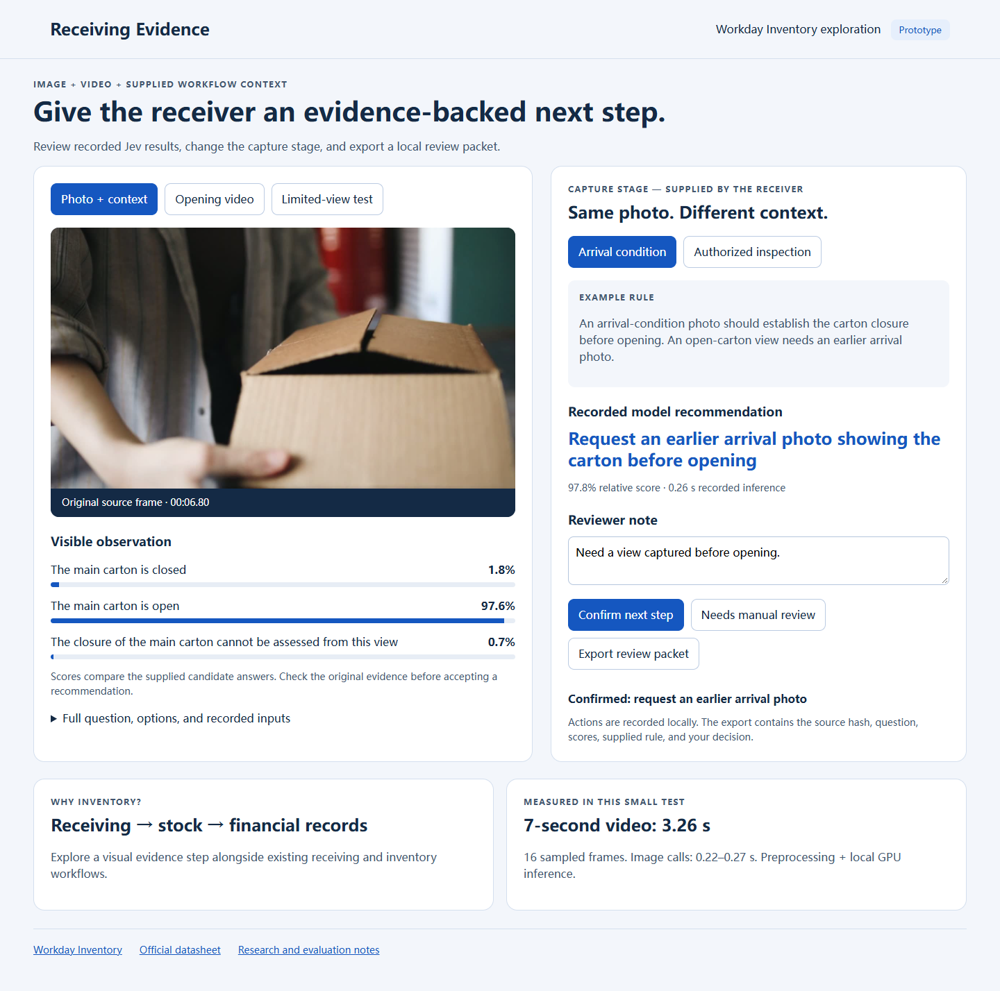
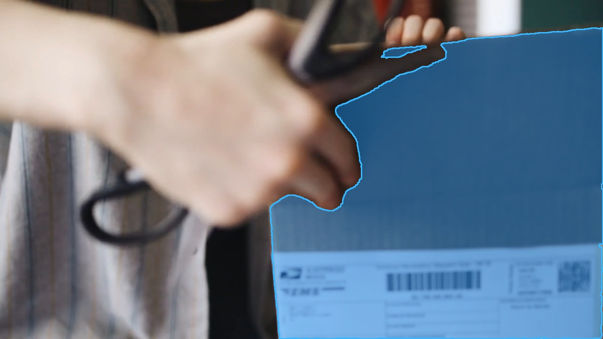

# Multimodal Receiving Lab

Turn a receiving photo or short clip into **a specific observation, a context-dependent next step, and an evidence packet a person can review**.

This learning project explores a visual evidence step alongside [Workday Inventory](https://www.workday.com/en-us/products/spend-management/inventory.html). Its [official datasheet](https://www.workday.com/content/dam/web/en-us/documents/datasheets/datasheet-inventory.pdf) describes barcode-enabled receiving, movements, traceability and links to financial records. The experiment asks what visual evidence could add to that workflow.

**[Watch the narrated technical demo](https://github.com/GuilinDev/multimodal-receiving-lab/releases/tag/v1.1.0)** · [Technical walkthrough](docs/technology.md) · [SAM 3.1 masks](docs/segmentation.md) · [Evaluation](docs/evaluation.md)



## Try it in two minutes

Python 3.10+ is sufficient. The included demo plays back eight recorded model calls; it needs no GPU, account or API key.

```sh
git clone https://github.com/GuilinDev/multimodal-receiving-lab.git
cd multimodal-receiving-lab
python -m http.server 8000 --bind 127.0.0.1
```

Open **http://127.0.0.1:8000/app/**. Switch between arrival condition and authorized inspection, confirm or override the proposed next step, and export a JSON review packet. Review actions stay in your browser; switching stages resets the pending decision. Nothing is sent to a Workday tenant.

The included media are transformed evidence fixtures from credited public stock clips, packaged with the case questions and results. They show normal handling, not a damaged delivery. See [source details](NOTICE.md).

The **SAM 3.1 masks** tab adds real text-prompted segmentation of the carton and its moving flaps. Toggle between the blue overlay and source frames. All 56 binary masks and frame records are included. SAM provides object geometry; Jev's recorded decisions still use the original inputs. [How the two outputs relate](docs/segmentation.md).



## The experiment

1. **Observe:** what visibly happens during a seven-second carton-opening clip?
2. **Change only context:** reuse the same open-carton photo for an authorized inspection and for evidence of arrival condition. The supplied rule calls for different next steps.
3. **Change only the image:** keep the arrival rule, then test closed and restricted views.
4. **Keep the failure:** a restricted crop received an 80.4% closed-carton score even though full closure was outside the view.

The scores compare the supplied alternatives. A large score does not establish real-world correctness. Keeping the source, question, rule, alternatives, revision and reviewer decision together makes the workflow auditable; it does not expose the model's internal reasoning.

## What technology is inside?

[TypeSafe Jev](https://docs.typesafe.ai/introduction) accepts state and typed questions and returns structured decisions. [Jev-Omni](https://huggingface.co/akhilaaa3/Jev-Omni) is a separate, independent open model with multimodal inputs and a similar decision interface; it is not an official multimodal release of TypeSafe's model.

Our video implementation samples **16 frames**, combines their visual representations with the text question, context and options, and runs a classification head over the final decoder representation. A softmax over the active answer slots yields relative probabilities. There is no generated answer paragraph. The visual input still requires substantial computation.

The recorded run used `akhilaaa3/Jev-Omni` revision `5addda86ddee081a68fb067477ea100c221b8917`, BF16 and SDPA on an NVIDIA GB10 GPU. The video call took **3.26 seconds**; seven image calls took **0.22–0.27 seconds**. Timings include preprocessing and inference, excluding upload and model loading. These are single requests, not a comparative benchmark. This project tested images and video, not audio.

## Learn by running the data

```sh
python scripts/evaluate.py --recorded
python -m unittest discover -s tests -v
```

For fresh inference on your own CUDA machine, follow [GPU setup](docs/gpu-setup.md). If you already run a compatible local `/predict` service:

```sh
python scripts/evaluate.py --base-url http://127.0.0.1:8765 --output runs/new-results.json
```

Recorded results are never overwritten. Fresh runs check the evidence hashes first and preserve every response, including errors. Re-encoded inputs may produce different scores; the supplied fixtures are byte-identical to the tested files.

## Suggested experiments

- Shuffle answer order and compare scores by answer text.
- Test progressively tighter crops and missing stages.
- Change the rule while keeping the photo fixed; change the photo while keeping the rule fixed.
- Include cases where none of the substantive answers is supported.
- Label a representative set before measuring calibration or choosing an automation threshold.

The eight examples are learning probes, not a representative inventory evaluation. The context rules are explicitly authored examples. No Workday integration or deployed product capability is demonstrated.

## Layout

| Path | Purpose |
| --- | --- |
| `app/` | Static, interactive recorded-results reviewer |
| `assets/` | Exact evidence fixtures and paired SAM/source playback |
| `data/` | Prompts, complete score vectors, 56 binary masks and source provenance |
| `scripts/` | Recorded/live evaluation and optional GPU inference |
| `tests/` | Evidence, pair integrity and response-validation tests |
| `docs/` | Technology, evaluation, setup and continuous narration |
| `video/` | Editable HyperFrames scene source; setup notes inside |

Personal learning prototype by Guilin Zhang. Code is Apache-2.0; media and upstream models retain their own licenses. See [NOTICE](NOTICE.md).
