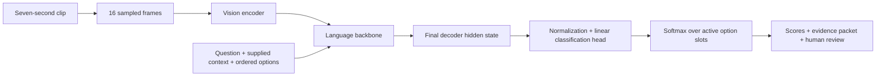

# From visual evidence to a bounded decision

## Text Jev and Jev-Omni

TypeSafe's [documentation](https://docs.typesafe.ai/introduction) describes Jev as a model for typed questions over state: Choice, Score and Noul. Its [launch article](https://typesafe.ai/blog/introducing-system-one-models-and-jev) attributes its training to RLCD, or reinforcement learning for calibrated decisions. Those descriptions belong to TypeSafe's product.

The independent [Jev-Omni model card](https://huggingface.co/akhilaaa3/Jev-Omni) describes a Gemma 4 12B IT-based classifier with text, image, audio and video inputs. Its author explicitly states that it is unaffiliated with TypeSafe and was not trained on Jev outputs. A similar interface does not establish a shared architecture, training method, speed or calibration.

This repository uses the independent model. It does not call TypeSafe's API or reproduce its RLCD training.

## The path this experiment actually used

The [pinned inference helper](https://huggingface.co/akhilaaa3/Jev-Omni/blob/5addda86ddee081a68fb067477ea100c221b8917/jev_omni.py) captures the final position of the decoder output. The decision head normalizes this vector, maps it to option-slot logits, masks unused slots, then applies softmax over the supplied options. Our service uses a single model forward call, without `.generate()`.

For this video's path, frames enter as ordered image content alongside a text prompt. The clip's audio track is not analyzed. Sampling can miss events between frames; this is not a continuous video monitoring system. Each question is a separate forward request in this implementation.

## Why compare this with a generative vision-language model?

A generative VLM can describe a scene, explain an answer and produce JSON. It usually decodes that answer token by token. Here, output is constrained to the listed choices through a classification head. That simplifies the output contract and removes answer-token decoding from this path. It does not remove image encoding, text processing, GPU memory requirements or the possibility of a wrong decision. We did not run a matched generative baseline, so the demo makes no comparative cost or speed claim.

## What the percentages mean

They are softmax probabilities within the current candidate set, conditioned on the media, wording and context. They are not percentages of pixels, object detector confidence, or demonstrated probabilities of correctness in receiving operations. Adding, reordering or rewording candidates may change them. Our stored `confidence` field is simply the highest option probability; it is not TypeSafe's confidence measure.

The restricted-view case is why the distinction matters. A high score cannot supply evidence that the camera did not capture. Calibration and review thresholds need representative labeled data.

## What is explainable here?

The evidence packet shows the input, options, complete score vector, supplied rule, source hash, model revision and human action. A reader can reconstruct what was asked and compare controlled changes. This is workflow traceability and behavioral evaluation. It is not a causal account of the model's internal reasoning, and the on-screen architecture animation is a schematic, not a measured attention visualization.

The [SAM 3.1 extension](segmentation.md) adds actual object masks as a separate spatial result. Its overlay is not Jev attention and did not generate the published Jev scores.
